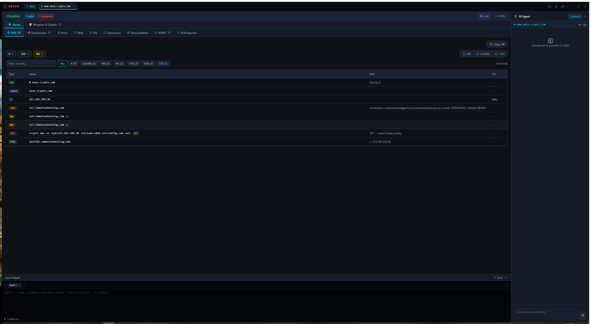

<div align="center">

```
██████╗ ███████╗ ██████╗ ██████╗ ███╗   ██╗
██╔══██╗██╔════╝██╔════╝██╔═══██╗████╗  ██║
██████╔╝█████╗  ██║     ██║   ██║██╔██╗ ██║
██╔══██╗██╔══╝  ██║     ██║   ██║██║╚██╗██║
██║  ██║███████╗╚██████╗╚██████╔╝██║ ╚████║
╚═╝  ╚═╝╚══════╝ ╚═════╝ ╚═════╝ ╚═╝  ╚═══╝
    ███╗   ███╗ █████╗ ███████╗████████╗███████╗██████╗
    ████╗ ████║██╔══██╗██╔════╝╚══██╔══╝██╔════╝██╔══██╗
    ██╔████╔██║███████║███████╗   ██║   █████╗  ██████╔╝
    ██║╚██╔╝██║██╔══██║╚════██║   ██║   ██╔══╝  ██╔══██╗
    ██║ ╚═╝ ██║██║  ██║███████║   ██║   ███████╗██║  ██║
    ╚═╝     ╚═╝╚═╝  ╚═╝╚══════╝   ╚═╝   ╚══════╝╚═╝  ╚═╝
```

**`[ OFFENSIVE INTELLIGENCE PLATFORM · v1.0.0 · WINDOWS x64 ]`**

[](https://github.com/NilyTnily/reconmaster/releases)
[](https://www.typescriptlang.org)
[](https://electronjs.org)
[](#-tool-arsenal--56-tools--11-phases)
[](LICENSE)

</div>

---

## ◈ MISSION BRIEFING

> *Target acquired. Clock is ticking. You need intel — fast.*

**ReconMaster** is a desktop-native offensive recon platform that chains **56 industry-standard security tools** into a single automated pipeline. One domain in. Everything out — subdomains, open ports, live web services, SSL issues, hidden directories, XSS vectors, SSRF parameters, leaked secrets, JS endpoints, CVEs, and full OSINT — rendered in a unified dark-mode interface with live terminal output and an AI co-pilot that explains every finding.

No terminal juggling. No copy-paste hell. Just target → scan → results.

---

## ◈ SCREENSHOT



---

## ◈ DOWNLOAD & DEPLOY

<div align="center">

### — PORTABLE · NO INSTALL REQUIRED —

| Build | Platform | Size |
|:-----:|:--------:|:----:|
| [**⬇ ReconMaster-1.0.0-portable.exe**](https://github.com/NilyTnily/reconmaster/releases/latest) | Windows x64 | ~80 MB |

</div>

> **First launch:** Open `Manage Tools` → select the tools you want → click Install.  
> Each binary downloads directly from its official GitHub release. Nothing bundled, nothing hidden.  
> Set a **GitHub API token** in settings to avoid rate limits on tool downloads.

---

## ◈ SCAN PIPELINE

```
  INPUT: target domain
     │
     ├──▸ [ DNS ]          A, MX, NS, TXT, CNAME, SPF, DMARC, CAA records
     ├──▸ [ SUBDOMAINS ]   Passive APIs · Brute-force · Permutations · Takeover check
     ├──▸ [ PORTS ]        Ultra-fast scan · Shodan passive · Service banners · CDN map
     ├──▸ [ HTTP ]         Live probing · Tech stack · Security headers · Screenshots
     ├──▸ [ SSL ]          Cert chain · Expiry · Weak protocols · Cipher suites
     ├──▸ [ DIRECTORIES ]  Recursive fuzzing · 403 bypass · IIS short-name · Params
     ├──▸ [ VULNERABILITIES ] CVEs · Misconfigs · CRLF · SSRF · Leaked secrets
     ├──▸ [ OSINT ]        WHOIS · Robots · Email harvest · Wayback
     ├──▸ [ CRAWL ]        JS analysis · Archive mining · API key detection
     ├──▸ [ XSS ]          Parameter scanning · JWT attacks · Payload injection
     └──▸ [ IDOR ]         Parameter enumeration & access-control checks
     │
  OUTPUT: structured results · live terminal · JSON export
```

---

## ◈ TOOL ARSENAL  `56 tools · 11 phases`

<details>
<summary><b>◂ SUBDOMAINS</b> — subfinder · amass · assetfinder · findomain · chaos-client · puredns · shuffledns · dnsx · alterx · gotator · subzy</summary>

| Tool | What it does |
|------|-------------|
| `subfinder` | Passive multi-source subdomain enumeration |
| `amass` | Deep active/passive enumeration with graph analysis |
| `assetfinder` | Lightweight domain asset discovery |
| `findomain` | Multi-source finder (crt.sh, VirusTotal, Sublist3r) |
| `chaos-client` | ProjectDiscovery public chaos dataset |
| `puredns` | Mass DNS brute-forcer with wildcard filtering |
| `shuffledns` | Mass DNS resolver via public resolvers |
| `dnsx` | Bulk DNS verification of discovered subdomains |
| `alterx` | AI-powered subdomain permutation engine |
| `gotator` | Deep permutation generator |
| `subzy` | Subdomain takeover vulnerability detection |

</details>

<details>
<summary><b>◂ PORTS</b> — rustscan · naabu · nmap · uncover · smap · cdncheck · asnmap</summary>

| Tool | What it does |
|------|-------------|
| `rustscan` | Scans all 65535 ports in under 3 seconds |
| `naabu` | Fast port scanner with service detection |
| `nmap` | Service version & script-based enumeration |
| `uncover` | Shodan/Censys/FOFA host discovery |
| `smap` | Passive Shodan InternetDB port lookup (no probing) |
| `cdncheck` | Detect CDN/WAF/cloud provider per host |
| `asnmap` | ASN to IP range mapping & org attribution |

</details>

<details>
<summary><b>◂ HTTP & FINGERPRINTING</b> — httpx · webanalyze · httprobe · unfurl · gowitness</summary>

| Tool | What it does |
|------|-------------|
| `httpx` | Full HTTP probe — status, title, tech, headers, score |
| `webanalyze` | Wappalyzer-based technology fingerprinting |
| `httprobe` | Rapid live host confirmation |
| `unfurl` | URL structure parsing & parameter extraction |
| `gowitness` | Automated screenshot of every live service |

</details>

<details>
<summary><b>◂ DIRECTORIES & PARAMS</b> — feroxbuster · ffuf · gobuster · nomore403 · shortscan · x8</summary>

| Tool | What it does |
|------|-------------|
| `feroxbuster` | Recursive directory brute-forcer (Rust-speed) |
| `ffuf` | Fast web fuzzer for dirs, files, vhosts, params |
| `gobuster` | DNS & directory brute-forcer |
| `nomore403` | 403 Forbidden bypass via header tricks & path encoding |
| `shortscan` | IIS 8.3 short filename (tilde) vulnerability scanner |
| `x8` | Hidden HTTP parameter discovery via diff analysis |

</details>

<details>
<summary><b>◂ VULNERABILITIES</b> — nuclei · crlfuzz · cvemap · jaeles · trufflehog · surf · osv-scanner</summary>

| Tool | What it does |
|------|-------------|
| `nuclei` | Thousands of CVE, misconfiguration & exposure templates |
| `crlfuzz` | CRLF injection scanner |
| `cvemap` | CVE lookup keyed to detected tech stack |
| `jaeles` | Signature-based web application scanner |
| `trufflehog` | Deep credential & secret scanning |
| `surf` | SSRF parameter discovery via parameter analysis |
| `osv-scanner` | Dependency vulnerability scan on exposed manifests |

</details>

<details>
<summary><b>◂ CRAWLING & JS ANALYSIS</b> — katana · gau · gospider · cariddi · xcrawl3r · subjs · jsluice · urlhunter · mantra</summary>

| Tool | What it does |
|------|-------------|
| `katana` | Deep JS-aware crawler with dynamic content support |
| `gau` | All known URLs from Wayback, AlienVault, Common Crawl |
| `gospider` | Fast web spider with link & JS extraction |
| `cariddi` | Crawler with built-in secret & endpoint detection |
| `xcrawl3r` | Configurable recursive crawler with scope control |
| `subjs` | Collect all JavaScript file URLs from live hosts |
| `jsluice` | Extract URLs, endpoints, and secrets from JS files |
| `urlhunter` | Mine Common Crawl archives without downloading them |
| `mantra` | Detect API keys and secrets in live HTTP responses |

</details>

<details>
<summary><b>◂ XSS / INJECTION</b> — dalfox · jwt-hack · qsreplace</summary>

| Tool | What it does |
|------|-------------|
| `dalfox` | XSS scanner with parameter mutation & context analysis |
| `jwt-hack` | JWT alg:none, key confusion, and brute-force attacks |
| `qsreplace` | Replace query parameters for mass payload injection |

</details>

<details>
<summary><b>◂ SSL / TLS</b> — tlsx</summary>

| Tool | What it does |
|------|-------------|
| `tlsx` | TLS version, cipher suite, cert expiry & chain analysis |

</details>

<details>
<summary><b>◂ UTILITY TOOLS</b> — mapcidr · interactsh-client · cloudlist · proxify · notify · hetty · cent</summary>

> These tools are available in the tool manager for manual / custom workflows.

| Tool | What it does |
|------|-------------|
| `mapcidr` | CIDR manipulation & IP range expansion |
| `interactsh-client` | Out-of-band interaction testing (SSRF, blind injection) |
| `cloudlist` | Cloud asset enumeration (AWS, GCP, Azure) |
| `proxify` | HTTP traffic capture, replay & matching proxy |
| `notify` | Push findings to Slack, Discord, Telegram, email |
| `hetty` | Full HTTP toolkit with intercept & search |
| `cent` | Community nuclei template manager |

</details>

---

## ◈ KEY FEATURES

```
  ▸ ZERO-CLICK FULL-CHAIN SCAN     One target in → 11 phases auto-executed
  ▸ 56 TOOLS AUTO-MANAGED          Install, update, enable/disable each from the UI
  ▸ LIVE TERMINAL                  Streaming output per tool, per phase
  ▸ AI CO-PILOT                    Explain findings, suggest attack paths
  ▸ TOKEN VAULT                    AES-encrypted local storage for GitHub API tokens
  ▸ PER-TOOL CONTROL               Toggle individual tools without re-running the scan
  ▸ SUBDOMAIN TAKEOVER             Subzy runs automatically on every discovery
  ▸ SECRET SCANNING                trufflehog + mantra + jsluice across JS & responses
  ▸ JSON EXPORT                    One-click export of complete scan results
  ▸ PORTABLE                       Single .exe, no installer, no dependencies
```

---

## ◈ COMING SOON

```
  ▸ SCHEDULED SCANS         Cron-based monitoring with delta alerts per target
  ▸ TEAM WORKSPACE          Shared targets, findings, and notes across a team
  ▸ PDF / HTML REPORTS      One-click pentest report generation
  ▸ CLOUD ENUMERATION       cloudlist auto-integration (AWS · GCP · Azure)
  ▸ OOB TESTING             interactsh built into the vuln scan phase
  ▸ CUSTOM TEMPLATES        Load your own nuclei template sets
  ▸ DARK WEB OSINT          Breach database & paste site monitoring
  ▸ API / HEADLESS MODE     Drive scans via REST for CI/CD pipelines
```

---

## ◈ TECH STACK

```
  UI          React 19 · TypeScript 5.9 · Tailwind CSS v4 · Lucide icons
  Runtime     Electron 36 · Node.js IPC (contextBridge + preload)
  Build       Vite 8 · electron-builder · Vitest
  Security    AES-GCM encrypted local vault for sensitive tokens
```

---

## ◈ BUILD FROM SOURCE

```bash
git clone https://github.com/NilyTnily/reconmaster.git
cd reconmaster
npm install
npm run dev          # development mode
npm run build        # build portable .exe → release/
```

> Requires Node.js 20+ and Windows x64.

---

<div align="center">

**Use only on targets you own or have explicit written permission to test.**  
*Unauthorized scanning is illegal. This tool is for authorized security research only.*

---

`MIT License  ·  © 2025 ReconMaster  ·  Built with controlled aggression`

</div>
